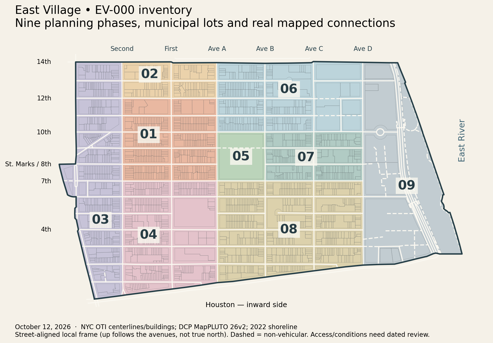

# EV-000 — boundary, topology and ownership inventory

**October 12, 2026 — completed locally.** The user's “go ahead” starts the first proposed session in the [East Village roadmap](EAST-VILLAGE-SESSION-PLAN.md). This session freezes geography and ownership records. The published revision 09 game is unchanged. **Next session: EV-001, loading/package design.** No later session or publication has started.

## Saved result

| Inventory | Measured snapshot count |
| --- | ---: |
| Tax lots intersecting the boundary by more than 1 m² | 2,207 |
| Municipal building footprints intersecting by more than 1 m² | 2,365 |
| Physical street/path/structure records, including boundary carriageways | 367 |
| Shared mapped endpoint nodes with a fixture coordinator | 221 |
| Roadmap units with one phase owner | 193: 190 future units + 3 protected scopes |
| Exact initial property packets | 9 packets / 53 distinct facade faces |
| Current runtime buildings protected by default | 203 |
| Separate accepted First & Tenth core building IDs | 23 |

These are **GIS records**, not business counts, complete facade counts or completed models. Different municipal footprint objects can share a BIN or parcel; the original IDs are retained. The 1 m² intersection threshold excludes numerical boundary slivers. Only two lots cross the adopted outer boundary: `1003160200` and `1009880075`; their outside portions remain context. The broad **390–725-session / 300–1,100+ model/tool-hour allowance remains provisional**. Parcel counts do not measure the time required to inspect and reproduce a distinctive storefront. Recalibrate after P01–P03 and again after eight detail sessions.

## Frozen boundary and date policy

The [boundary geometry](east-village-ev000/boundary.geojson) follows Bowery, the western Cooper Square branch via the Sixth Street connection, Astor Place back to Third Avenue, Third Avenue to Fourteenth, Fourteenth eastward, the East River shoreline and Houston back to Bowery. This includes the Cooper Square public realm and the Stuyvesant Street connection. The exact municipal segment IDs, local coordinate convention and perimeter rule are in [boundary specification](east-village-ev000/boundary-spec.json).

At divided streets, the planning polygon uses the inward carriageway centerline. The inventory separately retains adjacent boundary carriageways within 35 metres; this buffer **does not expand the property scope**. Interior streets include both sides. Perimeter property work covers the inward side. The terminal Fourteenth/Houston points extend to the shoreline at constant street-aligned local z: these are planning closures, not proposed roads. A single 1.328 m source join near the Houston bridge is explicitly recorded in [boundary joins](east-village-ev000/boundary-joins.json).

The shoreline is NYC's **2022 imagery product** (Manhattan acquisition March 18, 2022), used as a stable planning edge. It does not establish the October 2026 waterfront/flood-protection layout. The downloaded MapPLUTO records report **26v2**. Street-centerline status describes municipal mapping; even a `Constructed`/two-way classification does not establish current public access, gates or construction closures. Inspect dated conditions before the corresponding modeling session. No street-view photographs or paid imagery requests were acquired in EV-000.

## Topology decisions that future sessions must retain

The numbers below are NYC CSCL `PHYSICALID` values. They refer to saved geometry, not a new driving-network implementation. The [exception register](east-village-ev000/exceptions.json) provides machine-readable owners and IDs.

| Location | Municipal evidence and assigned treatment |
| --- | --- |
| First Street east of First Avenue | Segment `16769` joins Houston before Avenue A. `04-E01-1A` owns the real short street and adjoining convergence/site edge; its title is a corridor budget, not a through-road to A. |
| Fifth, First–A | No East Fifth centerline crosses Village View parcel `1004320001`. `04-E05-1A` owns the interior/site inventory; Fourth/Sixth/First/A frontage packets retain their exterior faces. |
| Fifth, B–C | `4091` is a stub from C, ending east of B at the school site. `08-E05-BC` includes parcel `1003870001`; do not connect through it. |
| Eighth/Ninth, A–B | Tompkins occupies parcel `1004030001`. Mapped Ninth segment `16646` has `TRAFDIR=NV`; it is not a drivable Ninth Street across the park. Four park-interior owners retain the entire site. |
| Eleventh, C–D | `4011` is a non-vehicular path C–Szold. `103211` is Szold's Tenth–Eleventh segment. `06-E11-CD` owns those connections and the Dry Dock/site inventory; no through-road to D is inferred. |
| Twelfth, C–D | `4367` is a non-vehicular C–Szold path; `4368` is the mapped street Szold–D. `103212` adds the Eleventh–Twelfth Szold segment to `06-E12-CD`. Keep the two access types distinct. |
| Thirteenth, B–C | `80037` ends between B and C. `06-E13-BC` retains the real stub and intervening site; no connection across the housing parcels is invented. |
| Fourteenth utility edge / northern Avenue D | Contrary to a simple “D ends at Thirteenth” assumption, CSCL maps `2748` from Thirteenth to Fourteenth and `19114` along Fourteenth C–D. `06-E14-CD` coordinates both. `19115` east of D belongs to `09-SITEN`. Current gates/public access remain unverified, so none becomes automatically drivable. |
| Second, C–D | `168666` joins Houston before D. `08-E02-CD` owns the actual short segment/convergence; preserve the diagonal Houston boundary. |
| Stuyvesant / Cooper | `03-STUY` covers `81220`–`81223`; the diagonal and short junction branch remain distinct. Cooper's split branches, plaza and boundary connection are retained in `03-COOPER` / western corridor rows. |
| FDR and waterfront | Highway, ramps, bridges, paths and service/site connections have separate owners and source classifications. No highway-driving gameplay or current ESCR layout is inferred. The Houston–Fourteenth clipping excludes the rest of East River Park and Stuyvesant Cove. |

## Ownership and completeness

- [Units](east-village-ev000/units.csv): all 193 roadmap rows have one phase owner and source-road references. A source can be referenced by adjoining units; its **single edit owner** is in [roads](east-village-ev000/roads.csv). References do not confer edit permission. Physical segments spanning several budget rows stay with one coordinator; explicit child extents can be transferred at packet start.
- [Lots](east-village-ev000/lots.csv) and [footprints](east-village-ev000/buildings.csv): every included identity has one default phase, plus touched phases and boundary clipping. Greatest-area overlap selects the parcel routing phase. This is not a claim that every facade belongs to that phase: avenue/park-edge packets often own the facing elevation of a parcel in an adjoining phase. Existing exact face ownership takes precedence.
- [Sites](east-village-ev000/sites.csv): institutional, utility, open-space, large and multi-building parcels remain visible even if there are few storefronts. The coordinator owns the **inventory**, not all future edits. Split large parcels into bounded interior/elevation/roof children; transfer exact feature IDs and retain street-facing ownership. Small gardens/vacant lots are still in the complete lot inventory even when municipal classification does not flag them as a special site.
- [Intersections](east-village-ev000/intersections.csv): shared source endpoints get one fixture coordinator, with adjoining unit references. These are not a complete curb/signal survey. Matching endpoint coordinates do not waive grade, access or on-site fixture checks; crossings with no shared mapped endpoint are not silently joined.
- [Protected registry](east-village-ev000/protected.json): current 203 runtime objects, separate 23 core IDs, 254 mapped faces including context and the 102 explicit revision 09 scope faces. Protection does not promote background faces to user acceptance. A later packet may explicitly transfer unreviewed context; no such transfer occurs here.
- [Next packets](east-village-ev000/next-packets.json): nine exact child packets, 53 unique faces, source geometry, BIN/BBL/OTI cross-references and one mass/roof owner per building. P03 owns `241822237:0`, excluding that Ninth return from the Ninth packets. Every face exists in the legacy source and excludes the protected registry. These records establish identity, **not fresh business observations or an engine-ready file allowlist**.

The [phase polygons](east-village-ev000/phases.geojson) partition the entire boundary without gaps or area overlap. Their simple local-frame cuts route parcels; they are not road geometry or instructions to split a building. Whole-area business enumeration, secondary facade enumeration, current access and photographic evidence are deliberately performed inside each small future corridor session. Nothing is marked visually complete by this inventory.

## Reproduction and checks

Run `python3 scripts/inventory-east-village.py` from the repository. It reads the frozen municipal snapshot, [frozen roadmap input](east-village-ev000/plan-input.json) and existing local geometry; it writes only this session's inventory/map artifacts. It uses the already available Python Shapely/Matplotlib packages and performs no network or game build. The separate [download script](../scripts/fetch-east-village-inventory.py) records bounded public requests, selected fields, service dates, hashes and complete ID-page agreement; it refuses to overwrite a completed snapshot. A future refresh needs a new dated destination and review.

[Validation](east-village-ev000/validation.json) covers boundary validity, phase coverage/overlap, unique lot/footprint/road IDs, all parent/phase assignments, unique future faces, protected-face exclusion and single mass ownership. The rendered map above was visually inspected. [Source manifest and credits](../source-data/east-village-ev000/README.md) document provenance, snapshots and limits. [Preservation audit](east-village-ev000/preservation.json) records unchanged runtime/source/private-image hashes. No new game, performance or storefront-fidelity test is claimed.

[Documentation validation](east-village-ev000/documentation-validation.json) records passing relative links, the reconstruction-skill validator, Python syntax, JSON/CSV agreement and whitespace checks. Runtime preservation independently matches all 18 exported files and 108 recipe/source hashes to the existing build manifest.

## Resume EV-001

Design a bounded loading/package change against the current Godot/static-hosted export. Read the actual resource graph, verifier, source-hash contract, address/map scope and deployment routes. Deliver an explicit file/asset ownership design, one proof seam using existing reviewed assets, and cold/warm loading, memory/frame-time and protected-view measurement criteria. Implementation of the proof is EV-002; integration is EV-003. The current PCK remains **102,660,112 bytes / 97.90 MiB**, SHA256 `8da68329347228060231d47f46e80c9d6233b6afb0469fd43611bdc83204b1d0`; the 100 MiB cap still applies.

Baseline remains `main` at `a2a90a3e08540e15f40e0ede0f8af14921f54675`; reviewed architecture `0de4b54dc9d0e711f11962688f0e6fca3aa01c50`. EV-000 and the preceding roadmap are local, uncommitted work. No fetch/push, CI run, deployment or live recheck took place in EV-000. Both private screenshots remain local/untracked and unchanged. Follow the user's next session instruction; no unattended queue is running.
