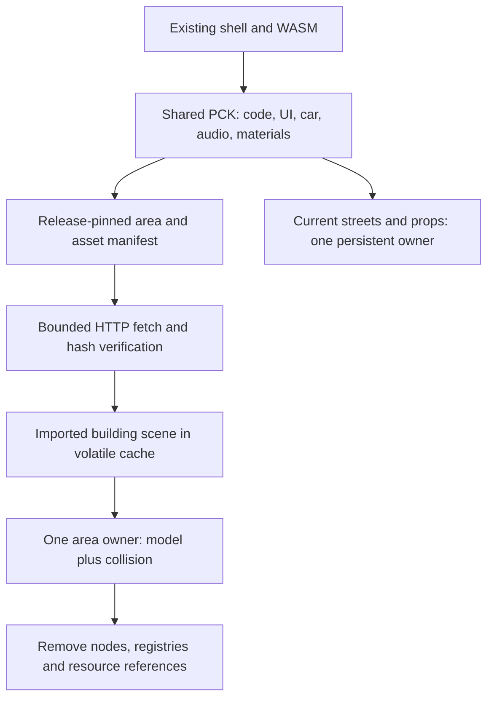

# EV-001 — loading and package design

**Completed locally, October 12, 2026. Design and native resource inspection only.** The user's next “go ahead” authorized EV-001 after the completed [EV-000 inventory](EAST-VILLAGE-EV000.md). EV-002 browser implementation, EV-003 integration and facade work have not started. No export, publication or paid job occurred. [Current checkpoint](../CODEX-HANDOFF.md) · [machine-readable design and exact ownership](east-village-ev001/loading-design.json).

Use **one shared startup PCK and individually fetched, content-hashed building scenes**, grouped by runtime area. Preserve the existing imported geometry, LODs, material identities, vertex colors and authored storefront detail. The current single-threaded Godot web player and static hosting can remain the starting point. The next session must establish whether scene decoding, activation and release work acceptably in the browser.

This design resolves package growth; it does **not** promise a faster initial load. With the existing 370 m camera range, most or all of today's small map can be visible from the opening area. Splitting its bytes alone cannot remove that requirement. Whole-neighborhood performance, photographic fidelity and storefront authoring time remain separate questions.

## Measured baseline

Branch `main` / cached `origin/main`: `a2a90a3e08540e15f40e0ede0f8af14921f54675`; reviewed architecture: `0de4b54dc9d0e711f11962688f0e6fca3aa01c50`. No remote refresh this session. Current PCK: **102,660,112 bytes (97.90 MiB)**, SHA256 `8da68329347228060231d47f46e80c9d6233b6afb0469fd43611bdc83204b1d0`. Existing verifier limit: strictly below 100 MiB.

The read-only [PCK census](east-village-ev001/package-census.json) checks all 493 directory-entry checksums and records their SHA256 values:

| Payload | Files | Bytes | MiB |
| --- | ---: | ---: | ---: |
| Imported building scenes | 203 | 94,708,573 | 90.32 |
| Imported textures (six surface maps + logo) | 7 | 6,317,756 | 6.03 |
| Fonts | 2 | 863,265 | 0.82 |
| Audio | 8 | 329,416 | 0.31 |
| Metadata, scripts and other resources | 273 | 387,168 | 0.37 |
| Directory/alignment overhead | — | 53,934 | 0.05 |

Non-building payload totals **7,897,605 bytes (7.53 MiB)**. This is a census subtraction, not a newly exported shared pack: some building import metadata would also be excluded, and a manifest/loader would be added. The largest building scene is `248142404`, **5,755,304 bytes (5.49 MiB)**. The WASM remains 39,514,754 bytes. Existing manifest compression estimates are not observed HTTP transfer sizes.

The installed engine is **Godot 4.7.2 stable, `ed1daf0bf`**, Compatibility renderer, non-threaded web export. All 203 compiled scene files in the ignored import cache match the reviewed PCK bytes. A [native probe](east-village-ev001/native-resource-probe.json) reports **zero external dependencies for all 203**. Three scenes, including the largest and detailed corner examples, were copied to independent scratch files and loaded as `PackedScene`: nonempty node/mesh-array/LOD/material signatures matched, and weak references to the sampled scene resources expired after release. This is a native feasibility result, not a WebGL image match or browser memory measurement. [Probe diagnostics and limitations](east-village-ev001/probe-notes.json).

## Resource and ownership design

Each manifest building record owns one compiled scene, its SHA256/byte count, existing building ID and source GLB hash, unchanged world transform, full visual bounds, collision recipe and area ID. Existing IDs remain stable. `loading-design.json` assigns all 203 models and proposed URLs; footprint boxes there are **not** final visual bounds. Compute bounds from transformed mesh geometry, including signs, awnings and protrusions, before using them for residency decisions.

The runtime-area ID controls resource lifetime. It does not replace EV-000 face/business/mass ownership, or authorize geometry edits to protected buildings. A later facade session can modify its assigned face without taking ownership of adjacent returns; a runtime area may contain several such authoring packets. Intersection and site components need unique owners before future road generation expands.

| Resource | Owner and lifetime |
| --- | --- |
| World, camera, car, UI, audio, weather, shared materials/shaders/textures | One persistent shared owner. Preserve appearance, controls and behavior. |
| Each building model and its collision body | Same area owner; stage, activate and retire together. Current collision bodies are siblings under `World`, so ownership must be explicitly refactored. |
| Current streets, sidewalks, basement voids, barriers, street furniture and procedural shop dressing | Build once and preserve for EV-002. These are not all inside the 203 scenes. |
| Network job, temporary scene bytes, strong scene references | Request/asset owner with generation token; cancel or release on retirement. |
| Source observations, licenses, private screenshots, legacy player | Preserve their existing ownership and provenance. No assets migrate from screenshots/reference photography. |

Do not call today's `build_streets()`, `build_props()` or `batch_details()` separately for each area. They use global coordinates/registries and global material batches. That would duplicate fixtures or prevent independent release. Later geographic sessions must form spatial batches under exact street/site owners while preserving canonical materials and geometry. EV-002 deliberately isolates the building-loading question first.

## Asset, release and cache contracts

1. **Compile without reauthoring.** Use the pinned Godot import output for the existing GLBs. Copy each compiled `.scn` unchanged to `/seventh/areas/assets/<sha256>.scn`. Do not parse GLBs in the browser or run the facade author merely to split the package. Preserve existing mesh LODs and material names because `world.gd.apply_materials()` relies on those identities and vertex semantics.
2. **Filter the shared export.** Replace `export_filter="all_resources"` with an explicit shared dependency closure that excludes external building scenes and their import entries. Keep required shared surface/font/audio/license files. Assert that no building payload remains duplicated in the base pack. Aim for at most **12 MiB**, with a proposed **16 MiB proof gate**; these sizes are design budgets, not measured exports. Retain the strict `<100 MiB` tracked-file limit. Initial per-scene gate: **8 MiB**; investigate oversized future scenes without deleting detail.
3. **Validate dependency closure.** Today's 203 scenes are self-contained. Future scenes with external references need explicit manifest dependencies and a verified shared path/UID resolution strategy. Fail the export on unsupported dependencies; never silently rely on an editor-only import cache. Bind the manifest to schema, exact engine/import version, source hashes and shared-pack hash. Keep actual source/release commit separate from the existing `build.json.sourceCommit` geographic baseline.
4. **Pin one release.** Use a content-hashed manifest URL and immutable asset URLs. All asset paths start `/seventh/` so root and direct Seventh routes agree. The shell pins the matching manifest/base pack; never mix releases or fall back to a newer mutable manifest mid-drive. Mutable shell/build metadata must revalidate; hashed assets can use long immutable caching after EV-003 verifies hosting headers. On a missing old-release asset, preserve the loaded scene and offer an explicit restart/retry using the existing loading presentation.
5. **Bound network and staging.** Use asynchronous `HTTPRequest`, initially two requests at a time, `use_threads=false`, with a bounded `download_file`. Stream to a `.part` file beneath `OS.get_cache_dir()/drivearound/<release>/`, check HTTP status, expected byte count and SHA256, then rename to `.scn`. Restrict URLs to the release manifest's expected same-origin paths. Allow a maximum 32 MiB of completed serialized staging bytes, plus at most two bounded in-flight files; this is not a decoded CPU/GPU memory budget. [Godot HTTPRequest documentation](https://docs.godotengine.org/en/stable/classes/class_httprequest.html).
6. **Decode explicitly on the main thread.** Load one ready scene per frame with `ResourceLoader.load(..., "PackedScene", CACHE_MODE_REUSE)`, then stage instantiation/material/collision work. Start with a 3 ms soft work budget per frame, but one decode/instantiate call can exceed it: the budget cannot preempt the call. Record every such duration. The present non-threaded web export cannot assume threaded background decoding. [ResourceLoader](https://docs.godotengine.org/en/stable/classes/class_resourceloader.html) · [web export limitations](https://docs.godotengine.org/en/stable/tutorials/export/exporting_for_web.html).
7. **Actually release resources.** Delete volatile serialized files once decoding and dependency resolution finish and no job still reads them. On retirement, free scene/collision nodes and remove strong references in `building_roots`, jobs, review maps, local-light lists and resource caches owned by the loader. Shared materials remain. Do not substitute hidden nodes for unloading. Godot's resources are reference counted; the engine cache ceases to retain a resource once all references are released. Test the actual browser result rather than assuming the WASM heap shrinks. [Resource lifecycle](https://docs.godotengine.org/en/stable/classes/class_resource.html).

Godot's upstream web implementation puts `get_cache_dir()` under `/home/web_user/.cache`, distinct from persistent `/userfs`. Verify this behavior in the pinned web build during EV-002; use the API, not a hardcoded OS path. Do not put streamed model bytes into the player's persistent settings directory or depend on IndexedDB availability. Browser HTTP caching is optional and distinct from model residency in WASM/GPU memory. [OS cache API](https://docs.godotengine.org/en/stable/classes/class_os.html) · [upstream web implementation, consulted October 12](https://raw.githubusercontent.com/godotengine/godot/master/platform/web/os_web.cpp).

Per-area PCK mounting is not selected: the installed `ProjectSettings` pack-method inspection exposed `load_resource_pack`, with no corresponding unmount method. Building scene files give this proof an explicit resource/file lifetime without depending on an unimplemented pack-unmount mechanism. This is a choice for the current engine, not a claim that alternative engines or custom pack systems are impossible. [Official pack workflow](https://docs.godotengine.org/en/stable/tutorials/export/exporting_pcks.html).

## Visibility, activation and travel

Maintain states `absent → requested → fetching → verified → staging → active → retiring → absent`, with an explicit failed state. Deduplicate by release/hash; keep generation tokens so canceled callbacks cannot activate retired content. Re-entering an area must reuse or replace the existing job deliberately, never create duplicate models/colliders.

Stage hidden visuals and disabled collisions, apply the current shared material/weather state, and activate both before the next physics step that can reach the area. Keep the current area active during preparation. Collision and visual readiness are one contract. Pause, focus loss, reset and camera-review teleports must cooperate with `ensure_ready`; a reset cannot place the car in an unready area. New lights join the current weather state and leave its registry on retirement.

Start conservatively with a **445 m car-relative retain radius**, based on the unchanged 370 m far plane, up to 45 m camera offset, and horizontal pan limits of 15/18 m. Measure distance to full visual bounds. The actual camera frustum and collision dependencies can pin content beyond the initial radius; these checks take priority. Evict beyond **475 m**, after **3 seconds** outside the required region. Camera changes/orbit/pan/zoom must not reveal unready geometry. No draw-distance reduction or simplified substitute storefronts are part of this design.

Prefetch outward from the required region using measured fetch/decode/warm latency, the car's 24 m/s maximum speed, reachable turns and camera movement. Queue by urgency; do not instantiate every prefetched file immediately. If latency or an error will expose missing scenery/collision, hold movement/camera advancement **before** the visibility boundary, retain current content, and use an existing-style loading/retry status such as “Opening the next block…”. Do not invent barrier geometry. Regular-network movement holds count as proof failures; explicit delayed/offline recovery scenarios test the fallback separately.

The current startup warm-up points and `buildings=203` browser signal require adaptation. Warm only ready views, distinguish catalog count from resident count, and show ready only when all opening camera/collision dependencies are present. Preserve the existing full catalog/face assertions. The current address HUD and schematic have limited geographic coverage; future route integration must extend their data while preserving presentation. EV-002 uses the existing geography and does not redesign them.

## EV-002: exact bounded proof

Two groups use the same external asset path. **EVP-REST stays resident** for this proof; **EVP-WEST retires and reloads** when outside/inside the required region. A simple First Avenue split would not exercise unloading reliably because the camera can reach across both halves.

| Group | Membership | Compiled scene bytes |
| --- | --- | ---: |
| EVP-WEST | 12 current west-context buildings, frozen IDs below | 6,989,332 |
| EVP-REST | Other 191 current buildings; explicit complement in design JSON | 87,719,241 |

EVP-WEST IDs: `241833259`, `241833267`, `241833274`, `241833286`, `241833290`, `241833291`, `241833299`, `241833312`, `241833322`, `241845001`, `241845013`, `978475216`. They were selected by existing footprint `maxX < -212`; that selection is not the eventual culling test. Confirm imported visual bounds before freezing activation thresholds. No authored geometry/texture/source schedule edits are assigned.

Route uses existing East Seventh, with the physical **Second Avenue seam at x = −229** in current shifted coordinates:

1. Open at First/Seventh `(0, 0)` with all opening-view dependencies ready.
2. Drive normally to `(260, 0)`; after the full bounds clear the retain/eviction region, dwell and confirm all 12 west models and their collision/resources retire.
3. Drive west through Second Avenue to `(−260, 0)` and return. All west content must be ready before its visibility/collision envelope is entered, well before the physical seam.
4. Repeat 10 round trips; check all four camera modes, orbit/pan/zoom and all three weather settings. Preserve the protected First/Seventh and reviewed storefront matched poses before/after. Existing terminal barriers still apply; use the saved keyboard-route harness, not a blind fixed-duration endpoint drive.

The proof does not establish city-scale residency while 191 buildings stay pinned. EV-003 must retain this limitation and establish how later spatial areas inherit the same ownership contract; no automatic neighborhood-wide conversion follows.

## File responsibilities for the next sessions

All changes in this table are **proposed**, not made in EV-001.

| File / area | Bounded responsibility |
| --- | --- |
| Proposed `scripts/area_assets.gd`, `scripts/area_streamer.gd` under the Godot project | Manifest integrity, request/cache lifecycle, readiness, residency, instrumentation. Keep geography recipes separate. |
| Existing Godot `scripts/world.gd` | Split shared-world setup from building activation; bind model/collider ownership; preserve material application, single shared prop generation and weather. |
| Existing `scripts/main.gd` | Startup readiness, coherent reset, camera warm-up and browser stats. Minimal loading status through existing UI/shell only where required. |
| Existing `assets/slice.json` and scene data | Preserve all 203 model/source records, transforms, 82 Seventh and 102 First/St. Marks face IDs. Keep external manifest a derived runtime mapping. |
| `export_presets.cfg`, `scripts/export-seventh.mjs` | Filtered base pack, hashed external assets/manifest, complete source/runtime hash closure, reproducible staging. Never regenerate facade assets merely to split them. |
| `scripts/verify-seventh.mjs` and existing browser review harness | Validate base and every external asset, ownership, catalog/resident distinction, byte preservation and new lifecycle scenarios without weakening original checks. |
| `dist/seventh/` | Future required tracked shared export and `/areas/` manifest/assets; no temporary files or private images. |
| `vercel.json` / static serving | EV-003 checks immutable-vs-mutable cache headers, MIME/GET behavior, both current routes and preserved legacy. No HTTP Range requirement. |

Today's exporter recursively copies the staged export over `dist/seventh` without removing old files. The new exporter must validate a complete staging result first, then replace its owned file set and remove only obsolete files named by its prior manifest. Do not delete unrelated `dist` content or leave stale chunks silently accumulating. Existing source metadata, credits and licenses remain required. File-set replacement locally and release consistency for an already-open browser are separate concerns: the release pin and explicit missing-asset recovery cover the latter. [Vercel cache-header behavior](https://vercel.com/docs/caching/cache-control-headers).

Freeze exact implementation allowlists at EV-002 start. Car handling, camera aesthetics/range, UI/audio design, legacy files, GLBs and authored source schedules remain protected. Small readiness hooks can touch callers where required; record them explicitly. Preserve `/` and `/seventh/` as current-player routes, `/index.html` as legacy, and absence of `dist/index.html`.

## Measurement and acceptance packet

Capture the unchanged revision-09 control before building the candidate, on the same machine/browser/viewport and weather. Save browser/version, renderer, power/visibility state, cache policy, source/build/manifest hashes, raw timings and failures. Do not compare different machines or an already-warm control with a cold candidate. Existing 60 FPS observations are historical, not this control.

| Check | Measurement and proposed proof gate |
| --- | --- |
| Identity and visuals | Catalog exactly 203; the two disjoint owner lists cover it once. Existing 82/102 face sets and all GLB hashes unchanged. Imported scene bytes match the census. Inspect served front/oblique/detail views at protected and seam poses in three weather states; material names/LOD preservation alone do not prove matching images. |
| Cold/warm startup | Five cold runs with cache disabled, five warm runs per build; record actual encoded transfer bytes, request count, ready/play times and every failure. Report samples, median and p95 (with the small sample size explicit). Candidate median no more than 10% worse and p95 no more than 20% worse than its matching control. No promised download reduction. |
| Normal travel | Record frame intervals, request/verification/decode/instantiate/warm/activation durations across first drive and ten round trips. Per-run p95 frame gap no more than control plus `max(2 ms, 10%)`; any newly introduced load-caused >100 ms hitch or ordinary-network movement hold fails and needs investigation. Keep first-drive stalls in the report; do not silently discard shader warm-up. |
| Ownership/collision | Exactly one instance and collider set per resident building; none after retirement. No gaps, duplicate street fixtures, phantom collisions or missing signs while approaching/crossing either direction. Preserve normal-key routes, all camera modes, reset, pause/focus and weather. |
| Release and memory | Capture resident IDs, nodes/resources, pending jobs, staging bytes and exposed renderer memory/object counters at identical east/west poses. Weak refs to retired scene resources clear. After warm-up, compare east-pose samples after cycles 2 and 10: no orphan-owner/resource counts and no sustained growth above `max(16 MiB, 5%)` in a comparable available live-memory metric. Report unavailable metrics; no memory pass from JS heap alone. WASM reserved capacity may stay high after actual resources are freed. |
| Failure/recovery | Inject missing file, bad hash, delay/offline, cancellation and rapid backtracking; reset/pause/focus during loading. Current area survives; stale jobs cannot activate; retries recover coherently. Wrong-release or corrupt data never loads. Explicit failure-scenario loading holds are expected and separately labeled. |
| Build/routes | Existing `npm run verify`, extended `npm run seventh:verify`, full runtime/source/manifest hashes, base/chunk size limits and localhost root/Seventh/legacy checks pass. CI and production checks belong only to a later authorized push; no publication is implied by EV-002/003. |

These are proposed engineering gates, not measured results or a photographic acceptance standard. If synchronous decode fails the frame budget, retain EV-002 and solve that bounded issue; do not claim completion from successful downloads. The largest scene and cancellation/release cases are essential. Instrument actual peak decoded/staging memory before setting a broader device budget; 32 MiB staging is not a claim about total RAM.

## Resume packet and state

**Next: EV-002 — implement and test this existing-asset proof locally.** Read the current handoff, this design, its exact JSON owner/asset lists and reproduction notes; verify baseline hashes, capture the unchanged browser control, then implement only the bounded loader/export changes and necessary readiness hooks. Finish the specified browser evidence and repairs. If a required gate remains unresolved, record the failing scenario and continue EV-002 next time. EV-003 integration precedes P01–P03 storefront expansion.

EV-001's [validation record](east-village-ev001/validation.json) binds inspected inputs and checks preservation. Analysis scripts/evidence, roadmap and current instruction updates remain **local and uncommitted**. No gameplay/export file changed. No browser streaming test, live recheck, CI, Git fetch/push or deployment ran. Native inspection cannot settle HTTP behavior, WebGL materials, shader hitches or web resource release.

The overall provisional **390–725 sessions / 300–1,100+ model/tool hours** remains unchanged. This session measures resource composition and prepares a test; detailed facade throughput still needs P01–P03 and the later timing checkpoint.
