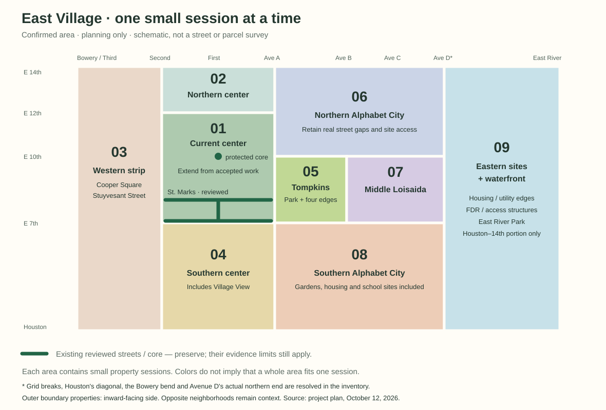

# East Village session plan

**October 23 laptop/restart checkpoint:** the roadmap is unchanged. The transferred 295-model result, build tools, GitHub login and ordinary Street View workflow are verified on the new laptop; all expansion work remains local/uncommitted while GitHub/live retain 203-model revision 09. The user is restarting VS Code/Terminal, then returning. [Restart instructions](../START-HERE.md#after-restarting-vs-code-or-terminal) · [Exact handoff](../CODEX-HANDOFF.md). No new block or publication has started. Tenth Second–First remains the proposed next delivery, with protected-core ownership preparation before modeling when assigned.

**October 14 cadence correction — current:** the user expected roughly one block per session. Ordinary delivery now means **one street segment between named intersections, both sides**, including its assigned street/corner detail. The small property packets remain internal working groups. Once a block is assigned, continue through those groups and their repairs without another routine “go ahead.” Preserve the individual storefront/building standard. [Exact workflow and next block](east-village-block-workflow.json).

**Current local geographic delivery: East Ninth First–Avenue A, both sides (`01-E09-1A`).** [Report and actual checks/limits](EAST-VILLAGE-E09-EAST.md): 50 planes / 41 owners, 42 shopfront/return records and 41 entries, 295 models. It includes the deferred 148 Ninth return while preserving the First face/mass. The preceding [Second–First Ninth block](EAST-VILLAGE-E09-BLOCK.md) is preserved. **Proposed next: `01-E10-21`, Tenth Second–First, both sides**, only on the next instruction; exact protected-core ownership must be prepared first. No automatic next block/publication.

The plan has **190 geographic coverage units plus three pilot ownership rows**, including streets, parks and special sites. These are not 193 guaranteed sessions: some coverage already exists, and complex sites/integration can take multiple sessions. Ordinary delivery remains roughly one complete assigned block. The former 630–1,340-session / 630–2,250+ hour scenario describes the old small-packet workflow and is retained only as history. The first two larger deliveries cover 34 and 50 assigned faces, with interruptions and unmeasured active time. Record elapsed durations without treating them as stable rates. The new 295-model package still loads every model initially; westbound chase has a measured frame-cost limit. Preserve detail while resolving capacity as the map grows. Collect several uninterrupted block samples before issuing a replacement whole-area hour/calendar forecast.

**Earlier October 14 checkpoint — roadmap; EV-000 through EV-003, P01–P03 and N01A/N01B complete locally under successive session instructions.** The user wants the whole East Village reconstructed one small session at a time, with enough attention and context for individually detailed businesses. They confirmed **East 14th Street to East Houston Street, Bowery/Third Avenue to the East River, including Alphabet City, Tompkins Square Park and the waterfront**. The [EV-000 inventory](EAST-VILLAGE-EV000.md), [EV-001 loading design](EAST-VILLAGE-EV001.md) and [EV-002 bounded browser proof](EAST-VILLAGE-EV002.md) are complete locally. [EV-003 integration](EAST-VILLAGE-EV003.md) is also complete locally. [P01](EAST-VILLAGE-P01.md) is complete locally: four facades and seven businesses at 137–143 First Avenue. [P02](EAST-VILLAGE-P02.md) is also complete locally: five east-side faces/five shops, with explicit gaps, setbacks, shapes and material review. [P03](EAST-VILLAGE-P03.md) completes both 145 First/Ninth corner faces. [N01A](EAST-VILLAGE-E09-N01A.md) completes 147 First’s Ninth return and 345–341 Ninth. [N01B](EAST-VILLAGE-E09-N01B.md) completes 339–333 Ninth. N02A was the next four-face packet under the earlier cadence; it is now the first internal group of the full Ninth block.

The recommended internal working group is **3–5 neighboring facade faces, usually 4–8 businesses**, adjusted to actual complexity. Finish its evidence, geometry, game review and repairs, then continue the assigned block. Internal groups are not separate user-facing sessions. The neighborhood is divided into nine geographic phases, with preparation, integration and final review sessions around them. The first property packets are in [First sessions](EAST-VILLAGE-FIRST-SESSIONS.md); every remaining corridor/site has a row in the [backlog](east-village-session-backlog.csv). The [planning data](east-village-plan.json) contains the same rows and estimate arithmetic; it is not an executable queue.

**Historical P03 small-packet allowance: about 630–1,340 small sessions, roughly 630–2,250+ model/tool hours.** The smaller packet size increases the prior 390–725-session allowance; retaining its count while halving ordinary packet capacity would hide work. This is a provisional capacity adjustment, not measured whole-area throughput or a delivery promise. EV-000 supplies municipal geography, but most business inventories remain uncounted. Recalibrate after eight detail sessions. [Original estimate and adjustment basis](east-village-p03/planning-baseline.json).

## Scope and what counts as finished

The western edge follows the real Bowery–Cooper Square–Third Avenue alignment, including the Stuyvesant Street connection within it. The northern/southern/eastern limits clip the site: the waterfront scope is only the Houston–14th band, not all East River Park or Stuyvesant Cove. The general neighborhood extent is consistent with the [Historic Districts Council's description](https://6tocelebrate.org/neighborhoods/east-village-lower-east-side/); the user's confirmed project bounds govern this plan.

Interior streets include both sides, every business/residential entrance, site edge, same-parcel return, visible roof/secondary face, sidewalk, street furniture and intersection. At the outer perimeter, the plan budgets the **inward-facing property side and the boundary road**. Outward-facing neighboring properties remain contextual; it does not silently add NoHo, the Lower East Side or Stuyvesant Town interiors. The exact polygon and perimeter parcel inventory are now frozen in [EV-000](EAST-VILLAGE-EV000.md).

Publicly visible parks, gardens, institutional grounds, housing sites, utility edges and waterfront infrastructure are part of the plan. Hidden interiors/courtyards remain explicitly unknown unless suitable evidence becomes available. Public roads stay drivable where the game supports them; park paths and private/service access are represented according to evidence. New pedestrian gameplay, highway driving, business interactions, a UI/audio redesign and a continuously live occupancy feed are separate product work.

The target is the user's **revision 09 storefront individuality standard**: observed sign layout/letterforms, material scale and finish, entrance composition, awning construction, seating, displays and small fittings. Tile Bar remains the named example of individuality. A shared component may reproduce a shared construction method; it must not erase a shop's distinctive design. Preserve the existing cozy presentation. [Detailed standard](skills/reconstruct-street/references/storefront-individuality.md).

Completion means complete assigned coverage and actual source-to-game review at this working standard, with limitations visible. It does not certify measured architectural dimensions, hidden surfaces or calibrated photographic 1:1. Changes in imagery dates, seasonal seating and construction stay explicit; do not splice incompatible conditions into an unlabeled supposedly current scene.

## Preserve the work already done

| Existing work | Treatment |
| --- | --- |
| East 7th, Second Avenue–Avenue A, both sides | Preserve the accepted west/east passes and First & Seventh corner; audit joins when neighboring work arrives. |
| St. Marks, Second Avenue–Avenue A, both sides | Preserve revision 08 architecture and user-endorsed revision 09 storefronts, including their documented returns. |
| First Avenue, East 7th–St. Marks | Preserve revision 09 and protected corner faces. |
| First & East 10th accepted core | Carry forward protected geometry and separate provenance. Review integration when the route reaches it; preservation does not mean its Godot integration is already finished. |
| Original ten-block game, UI/audio/controls, routes, private screenshots | Preserve; expand the current Godot experience through bounded future tasks. |
| Other legacy map buildings | Useful geographic/massing input, **not** already completed at revision 09 storefront quality. |

Planning baseline: `main` / cached `origin/main`, **`a2a90a3e08540e15f40e0ede0f8af14921f54675`**. Reviewed architecture is `0de4b54dc9d0e711f11962688f0e6fca3aa01c50`; the live revision remains unchanged. The planning baseline had 203 objects; P01 brought it to 207; P02 brought it to 212; P03 brought it to 213; N01A brought the local slice to 217; N01B brings it to 221, preserving all preceding 217 models. The legacy map has 615 building objects and 672 mapped frontages in its much smaller Seventh–Twelfth / Second–Avenue A area, including boundary context. Neither count is a whole-East-Village inventory.

## Block delivery and internal working groups

The block is the user-facing deliverable. Smaller evidence/authoring groups keep the working context focused; they do not end the authorized task. Keep the complete block inventory, exact ownership and remaining-face checklist on disk. Save progress before context resets and resume the same block.

Batch compatible changes into exports and review the affected facades, businesses, entrances and neighboring joins. Preserve closeups and obliques for every shop, with actual repair where needed. Package integrity, protected-model checks and changed boundary/collision smoke checks still apply when their inputs change. Consolidate the broad driving/camera/address/weather/performance suite on the final integrated block. Repeat it sooner when shared/runtime changes, failures or unresolved concerns warrant it. Never reuse an old screenshot as evidence of changed geometry.

Record one concise current checkpoint and milestone history. Avoid copying all historical reports or repeating a full end-of-session ceremony after each internal group. Shared components remain evidence-driven and retain each storefront's unique composition; this workflow does not authorize a quality reduction, new paid jobs or publication.

## Preparation before adding substantial geography

| Session | Deliverable | Completion condition |
| --- | --- | --- |
| **EV-000 — complete locally** | Freeze the full boundary, road/site topology, protected IDs and ownership inventory; resolve irregular streets and outer perimeter policy | Every corridor/site belongs to one phase; detailed parcel IDs exist for the next few packets. Whole-area counts are marked measured vs provisional. Split western/eastern inventory if needed. |
| **EV-001 — complete locally** | [Loading/package design](EAST-VILLAGE-EV001.md) against the real export and hosting setup | Shared PCK plus compiled building scenes, exact 12/191 proof ownership and before/after gates; native inspection only. |
| **EV-002 — complete locally** | [Bounded loading proof](EAST-VILLAGE-EV002.md) using existing reviewed assets | Twelve west-context scenes/colliders release/reload, 191 remain resident; paired loading, resource, recovery and preservation checks pass within recorded limits. |
| **EV-003 — complete locally** | [Bounded loading integration](EAST-VILLAGE-EV003.md) | Release/cache, exact ownership, eight current route legs and absent-area resizing verified; preserve detail and record candidate CDN checks for later publication. |

Allow **4–6 sessions** for these four outcomes; an inventory or technical outcome may need a continuation. EV-000 through EV-003 are complete locally under the user’s successive instructions. P01–P03 completed the first 11 faces; N01A and N01B add eight, for 19 new faces. Preparation itself did not author facades.

The published revision-09 PCK is **102,660,112 bytes (97.90 MiB)**, only **2,197,488 bytes** below the enforced 100 MiB cap. [EV-003](EAST-VILLAGE-EV003.md) now has a local **7,982,220-byte (7.61 MiB)** shared pack plus 203 unchanged external scenes totaling 94,708,573 bytes. [Verifier](../scripts/verify-seventh.mjs) · [runtime limits](skills/reconstruct-street/references/repository-adapter.md). This resolves the single-file capacity constraint for the proof without simplifying storefronts. All 203 scenes still load initially, and 191 remain pinned; total opening transfer is nearly unchanged. Loading and live-resource tests pass for the bounded 12/191 split, not for whole-area growth. EV-003 completes the bounded local integration; all future additions still need measured package/route/resource checks. Actual immutable caching saves warm scene transfers, without reducing cold content.

Preserve `/` and `/seventh/` on the current experience, `/index.html` on the legacy game, and the absent `dist/index.html` invariant. The existing address HUD/route schematic is geographically limited; inventory its extension needs in EV-001 and include necessary geographic updates in later route integration, preserving the interface design.

## Geographic sequence

The ranges below retain the **historical small-packet work allowance**. They are not counts of current block delivery sessions. Street-level rows, bounds, special cases and ranges are in the [CSV backlog](east-village-session-backlog.csv). Some rows will split further when businesses are counted. Do the listed streets one at a time, finish the adjacent avenue seams, then advance; don't work on all rows at once.

| Phase | Geographic work, in proposed order | Historical detail/site packets |
| --- | --- | ---: |
| **01 — Extend the current center** | First Avenue St. Marks–Ninth pilot; Ninth, Tenth, Eleventh and Twelfth between Second and A; remaining First/Second Avenue faces from Seventh–Twelfth. Preserve accepted streets/core. | 60–107 |
| **02 — Finish the northern central strip** | Thirteenth and the inward side of Fourteenth between Second and A; First/Second Avenue Twelfth–Fourteenth. | 24–48 |
| **03 — Western East Village** | St. Marks and Ninth–Fourteenth west to Third, then Seventh down through First west to Bowery/Cooper; western boundary frontage, Stuyvesant Street, Cooper Square and Houston west of Second. | 73–171 |
| **04 — Southern central streets** | Sixth down through First between Second and A; First/Second Avenue Houston–Seventh; inward Houston frontage and Village View site. | 89–178 |
| **05 — Tompkins Square and its edges** | Seventh and Tenth A–B; A/B park-facing corridors Seventh–Tenth; four small park-interior sections. | 22–44 |
| **06 — Northern Alphabet City** | Tenth B–D; Eleventh–Fourteenth A–D, retaining real gaps/stubs; A/B/C/D northern avenue sections, Szold Place and intervening recreation/housing sites. | 65–146 |
| **07 — Middle Loisaida** | Seventh, Eighth and Ninth B–D; C/D Seventh–Tenth and connecting site edges. | 30–72 |
| **08 — Southern Alphabet City** | Sixth down through Second A–D, gardens and school sites; A/B/C/D Houston–Seventh; inward Houston frontage. Clip to Houston's actual diagonal. | 96–218 |
| **09 — Eastern sites and waterfront** | Land east of D, housing/utility sites, service/loop streets, FDR and access structures, then East River Park/river edge, divided into Houston–Sixth, Sixth–Tenth and Tenth–Fourteenth bands. | 20–37 |
| **Total geographic work** | 190 proposed corridor/site units, plus three protected existing-scope records | **479–1021** |

The neighborhood-wide landmark budget lives within these ranges and the contingency, not a second overlapping list of the same buildings. Examples such as St. Mark's-in-the-Bowery, Cooper Union, churches, libraries, theaters, schools, gardens, public housing and utility buildings need their own component/site packets when their corridor is inventoried. A landmark split transfers its face IDs out of the parent packet before work starts.

Each site row also owns the otherwise unassigned visible secondary elevations, rooflines and internal open-space details for its parcels. For ordinary street parcels, the first facade packet establishes a building owner for those items; later street-facing packets reference it. This prevents a street-only checklist from silently omitting entire inner sites.

## Grid exceptions and shared ownership

The schematic is a planning diagram, not a claim that every grid cell is a public street. Tompkins interrupts Eighth/Ninth between A and B. East Fifth has interruptions at Village View and the B–C school site. Eastern Eleventh/Twelfth/Thirteenth, Szold Place, Avenue D's northern end and the Fourteenth/utility edge are resolved as mapped connections in EV-000, with current access checks still pending. The [numbered-street overview](https://en.wikipedia.org/wiki/List_of_numbered_streets_in_Manhattan) is a preliminary cross-check, not the final road inventory. Municipal geometry and the exact exception owners are now recorded in [EV-000](EAST-VILLAGE-EV000.md); current access/site conditions still require dated views when their packets start. No straight road is drawn merely because a number repeats.

Use the [NYC DOT map](https://www.nyc.gov/html/dot/html/bicyclists/bikemaps.shtml) for street/network context, with its stated limitation that it may not reflect real-time conditions. Avenue B's [June 29, 2026 redesign announcement](https://www.nyc.gov/html/dot/html/pr2026/construction-upgrade-ave-b-open-street.shtml) and the [ESCR project updates](https://www.nyc.gov/site/escr/project-updates/project-updates.page) make the park-edge/waterfront date policy especially important. A planned future layout is not evidence that it exists on the chosen scene date. These pages were consulted for planning on October 12; fresh per-property photographic research has not started.

- **Facade:** one stable `buildingId:faceIndex` owner, with business sub-IDs and dated observations. A corner return shown as context is not automatically an editable face. Already authored returns stay protected.
- **Shared building mass/roof:** one building owner. Subsequent facade work may depend on it but must not re-create it independently.
- **Sidewalk:** adjoining frontage packet owns its side between agreed parcel/seam points; fixed corner fixtures are assigned to the intersection owner.
- **Carriageway/intersection:** one corridor/intersection owner, with stop-line-to-stop-line extents and shared fixture IDs. The first assigned intersection pass supplies the crossing; later approaches verify the join rather than duplicate signals/curbs.
- **Park/large site:** outer gates/fences belong to perimeter packets, internal landscape to the named site packet, unless the inventory transfers an explicit feature ID. No gaps or duplicate objects at boundaries.

At the start of each geographic unit, enumerate **both sides in full**, including residential-only properties, below-grade units, vacant/construction sites and unnamed businesses. Then create ordered internal work groups such as `01-E09-21-N01`, `N02`, `S01`. The child records carry exact parcel IDs and endpoints. The backlog's provisional session ranges are not a substitute for this inventory.

## Review and continuation

An assigned block authorizes its necessary research, implementation, internal groups and repairs through the block outcome. Do not stop simply because four facades are complete. Keep `observed`, `modeled`, `reviewed-candidate` and `user-accepted` distinct. Missing evidence stays explicit; continue independent assigned work while addressing it.

Each block finishes with integrated route and preservation checks. Across blocks, add broader loading/route integration when cumulative growth, shared changes or measured regressions justify it; keep phase-end review. The former automatic eight-small-session cadence is historical. A genuine tool/session limit or persistent dependency may require a resumable handoff; describe the incomplete block honestly. Proceed to another block on the user's next direction. Publication remains separate.

## Historical small-packet estimate and new calibration

The P03 checkpoint keeps completed pilot counts and non-street site ranges fixed. It raises each still-planned ordinary street row to 1.5× its old lower allowance and 2× its upper allowance, rounded upward. This is a conservative planning choice based on reducing the former 6–10-face target to 3–5, **not** an observed density multiplier. The known 42-face Ninth corridor uses 9–14 sessions directly (ceil(42/5)–ceil(42/3)); business complexity may require more.

| Allowance | Sessions |
| --- | ---: |
| Geographic detail/site packets, summed from the revised backlog | 479–1021 |
| Preparation/loading dependency | 4–6 |
| Integration, roughly one per eight detail sessions | 60–128 |
| Final whole-area routes/review | 4–6 |
| Subtotal | 547–1161 |
| 15% additional allowance | 83–175 |
| **Rounded planning total** | **about 630–1,340** |

Underlying arithmetic is 630–1336 sessions. At 60–100 minutes for ordinary work, that multiplies to 630–2,227 hours; communicate **630–2,250+ hours** because special sites and technical sessions remain 90–180 minutes. This is model/tool elapsed work, not continuous user attention. User review/wait time is separate. No cost estimate is implied.

| Sustained pace | Approximate calendar duration |
| --- | --- |
| 5 sessions/week | 126–268 weeks |
| 10 sessions/week | 63–134 weeks |
| 20 sessions/week | 32–67 weeks |

These scenarios assume the cadence continues; they are not scheduled jobs or delivery dates. The [original October 12 estimate](east-village-p03/planning-baseline.json) remains historical. Calibrated types and actual business inventories must replace this interim range after eight detail sessions.

What is known: revision 08 covered 102 editable faces; revision 09 refined 80 business/return records on 57 faces. The baseline capture to revision 08 implementation commit spans about **3h13m**, and the instruction commit to revision 09 implementation spans about **2h14m**. Those are repository timestamp intervals, **not instrumented active-work timings**; they include reused geometry and do not establish new-area throughput. The small-session estimates deliberately allow repeated setup and much more localized review. [Revision 08](SEVENTH-ENGINE-08.md) · [Revision 09](SEVENTH-ENGINE-09.md).

After P01, P02 and P03, compare an ordinary mixed storefront group, an opposite-side group and a complex corner. Record faces/businesses completed, unique components needed, source gaps, total time by stage, repair/review time, memory/package change and user-requested revisions. After eight completed sessions, compute a median and slower-case time **by session type**. Estimate remaining work from the actual remaining face/business inventory and measured type mix; don't multiply the fastest shop by the whole city. Recalculate at every phase boundary. If quality stays strong with larger packets, merge future simple packets; if review is squeezed, split them and update the forecast.

## Next session when requested

**01-E09-21: finish East Ninth from Second Avenue to First Avenue, both sides.** The [block record](east-village-block-workflow.json) lists all 34 remaining exact faces, eight completed faces and the protected P03 return. [N01B](EAST-VILLAGE-E09-N01B.md) remains the latest completed build. Start with N02A internally, then continue the remaining north/south groups without a routine handoff between them. Derive the narrow supporting road adapter from the complete assigned corridor; preserve all 221 current models. 147's First-facing detail, 148 Ninth and neighboring street blocks remain outside this delivery.

Copyable later instruction:

> Read the current handoff and block workflow. Complete **[street block ID, endpoints, both sides]** using the individual-storefront standard. Continue through its internal groups, review and repairs without stopping after each group. Save progress as needed, preserve protected work and record actual timing. Leave publication and the next block for my next instruction.

This sample is a resume aid, not a current implementation instruction.

### First facade timing checkpoint

P01 took approximately **78 minutes elapsed** through its local handoff, including research, the first expansion adapter, export failures/repairs, individual storefront review and browser tests. It contains four facades and seven businesses. This is one measured packet, not a stable per-business rate or full-project forecast. Its timing is one input to the P03 adjustment above. [Exact trial/timing record](east-village-p01/progress.json).

P02 completed five facades/five shops with 50 final detail views and 13 gameplay views. Its [timing and trials](east-village-p02/progress.json) include four model exports, five engine builds and finer junction/fire-escape repairs. The two packets have different work mixes.

P03 adds one complex two-face corner with two businesses across three shopfronts, 35 final detail views, 18 gameplay views, six driving legs and fresh before/after startup runs. Its [progress record](east-village-p03/progress.json) contains final elapsed time; stage activities overlap and were not independently instrumented. Three packets do not establish stable type percentiles. The next N01 parent is split into N01A and N01B (four faces each); other 7–8-face parents must be split before implementation. The 53 initial unique faces are retained with no loss or duplicate execution ownership.

N01A completes the fourth detail session: four faces, five shopfronts/four businesses and three residential entries, 59 final detail views, 18 gameplay views and four exports/four builds. [Final elapsed time and trials](east-village-e09-n01a/progress.json) are the fourth calibration sample. Startup runs are final-only, not paired before/after. Retain the provisional forecast until the eight-session checkpoint; four mixed sessions do not establish type percentiles or per-business rates.

N01B is the fifth detail sample: four faces/six shops/four residential entries; 58 final detail and 18 gameplay views, five exports/builds and paired before/after startup runs. [Elapsed time/trials](east-village-e09-n01b/progress.json): **614.2 minutes wall elapsed, including a laptop shutdown**. Active time was not measured; this record is excluded from timing calibration. Four earlier elapsed records remain comparable. N01 parent is complete, N02 split; eight of 42 editable Ninth faces are locally complete. Retain the forecast until eight samples.
